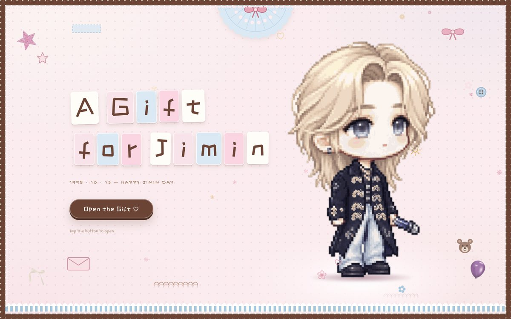

# A Gift for Jimin · 给朴智旻的生日网站

一个**单文件**的手账（剪贴簿）风格生日应援网页 —— 打开就是一份手工拼贴的礼物。

> 底色是淡粉的做旧奶油纸，深棕做边框和手写标题，低饱和雾霾蓝做点缀块面；
> 邮票齿孔边框、蓝色蕾丝餐垫、卷曲花边、蝴蝶结缎带、毛绒小熊、纽扣、信封、星星挂饰
> —— 全部是 CSS / 内联 SVG 现画的，没有一张贴图素材。

**在线预览**　→ <https://myangelmylovemyjimin.com/>

> 自定义域名。GitHub Pages 默认地址是 `https://<用户名>.github.io/myangelmylovemyjimin/`，
> 仓库根目录的 `CNAME` 文件把它指向了上面的域名。



---

## 七个板块

| 板块 | 内容 |
| --- | --- |
| **Home** | 鼠标跟随的像素小人（朴智旻），开场标题逐字贴在纸片上 |
| **Pick a Room** | 五个板块的入口，中间站着小人 |
| **Tour Looks** | ARIRANG 巡演换装（96 套造型）+ 墨卡托投影世界巡演路线图，往下滑还有 96 套造型总览（**真人现场原图 + 像素小人并排**，点一下直接换上） |
| **Photowall** | 半透明面板照片墙（虚线边），拍立得可以拖动、点击放大；面板顶上手帐夹夹着、左右两边也骑着夹子；**板子左边一栏是粉色铁丝篮子**，篮子里的 28 件 Y2K 小物和长尾夹可以拖到板上任意装饰（拖出板外会弹回篮子） |
| **His Albums** | FACE / MUSE 专辑墙 |
| **Jimin on Weverse** | 手机壳里的 WVS 动态流（POSTS / GRID / STORY 三个页签） |
| **Letters for Jimin** | 给智旻的信 + 大家写的小纸条（存在浏览器 localStorage） |

## 本地运行

不需要构建、不需要依赖，随便起个静态服务器就行：

```bash
# 任选一种
python3 -m http.server 8899
npx serve .
```

然后打开 <http://localhost:8899>。
（直接双击 `index.html` 也能看，但 `file://` 协议下部分浏览器会拦截音频和 localStorage。）

## 部署 · GitHub Pages + 自定义域名

一键脚本（会设好提交身份、提交、挂远端、推送）：

```bash
bash publish.sh <你的GitHub用户名>
```

推完之后开 Pages：**Settings → Pages → Source 选 `Deploy from a branch`，
Branch 选 `main`、目录 `/ (root)`，Save**。

### DNS 记录（在域名商那边加）

根域名 `myangelmylovemyjimin.com` 用 A / AAAA 记录：

| 类型 | 主机记录 | 记录值 |
| --- | --- | --- |
| A | `@` | `185.199.108.153` |
| A | `@` | `185.199.109.153` |
| A | `@` | `185.199.110.153` |
| A | `@` | `185.199.111.153` |
| AAAA | `@` | `2606:50c0:8000::153` |
| AAAA | `@` | `2606:50c0:8001::153` |
| AAAA | `@` | `2606:50c0:8002::153` |
| AAAA | `@` | `2606:50c0:8003::153` |
| CNAME | `www` | `<你的GitHub用户名>.github.io` |

然后在 **Settings → Pages → Custom domain** 填 `myangelmylovemyjimin.com`，Save；
等 DNS 生效（最长 24 小时）后勾上 **Enforce HTTPS**。

## 技术说明

- **纯静态**：一个 `index.html`（约 150 KB，HTML + CSS + JS 全在里面）+ `assets/`。
- **零外部依赖**：字体、图片、脚本全部本地，不请求任何 CDN —— 断网也能跑，
  国内网络环境也不会因为 Google Fonts 打不开而掉字体。
- **没有框架、没有构建步骤**，改完刷新就能看到。
- 配色全部走 CSS 变量（`:root` 里的 `--paper / --brown / --pink / --blue` 等），换主题只改十几行。
- 手绘元素是运行时拼的内联 SVG：蕾丝餐垫、卷曲花边、蝴蝶结、纽扣、小熊、信封、星星。
- 像素小人来自巡演造型图集，用 CSS `steps()` 做逐帧动画。

### 字体（自托管）

`assets/fonts/` 里是自己托管的 woff2，由 `build_fonts.py` 从 Google Fonts 抓取并子集化：

| 字体 | 用途 | 大小 |
| --- | --- | --- |
| `zcool-kuaile-400.woff2` | 正文 + 标题（中文字体，子集化） | 440 KB |
| `caveat.woff2` | 手写标题（可变字体，500–700） | 72 KB |
| `gochi-hand-400.woff2` | 小标签、空状态提示 | 19 KB |

**ZCOOL KuaiLe 是中文字体，完整包有 1.4 MB**，所以做了子集化：
只保留「站内所有出现过的字」+「GB2312 一级字库（3755 个常用字）」，
压到 440 KB 的同时，留言板里用户自己打的常用汉字也能正常显示。

改了页面文案之后重新生成：

```bash
/Users/whitekunckles/.workbuddy/binaries/python/envs/default/bin/python build_fonts.py
```

其它构建脚本（都只在改素材时才需要跑）：`build_assets*.py` 负责把原始素材切成图集、
`build_route.py` 把 61 个场馆坐标做墨卡托投影重算、`build_fonts.py` 抓字体并子集化、
`build_thumbs.py` 出造型缩略图、`build_looks_real.py` 配真人原图、`build_felt.py` 抠毛毡素材。

## 造型总览缩略图 · build_thumbs.py

巡演页往下滑有一个「All the Looks」总览，96 套造型全铺开、点一下直接换上。
原图 `assets/looks/` 是 330×560 左右、单张约 93 KB，96 张近 9 MB；
总览格里一张只显示约 85px 宽，所以另存了一套 1/4 整数倍最近邻缩放的缩略图到
`assets/looks-thumb/`，**合计约 1.3 MB**（像素画按整数比缩小才不会糊边）。

页面上缩略图带 `loading="lazy"`，只有用户真的往下滑时才会下载。

换掉 `assets/looks/` 里的图之后重跑一次：

```bash
/Users/whitekunckles/.workbuddy/binaries/python/envs/default/bin/python build_thumbs.py --force
```

## 造型总览的真人原图 · build_looks_real.py

总览里每一格是「真人现场照 + 像素小人」。真人照从「朴智旻造型/」根目录的巡演原图里配，
命名和精灵图同源（`260701-BTSWORLDTOUR'ARIRANG'INBRUSSELS.jpg` ↔ `…PNG`），
按 **(日期, 城市)** 对上，裁成 3:4 竖构图存到 `assets/looks-real/`（约 1.9 MB）。

- **96 套全部配上了**。
- 根目录里混了 5 张「精灵图另存成的 jpg」（白底），脚本按四边一圈的亮度自动跳过；
  另外 32 张微信存下来的 `2xxxxxxx_.pic_hd.jpg` 名字里没有日期城市，直接忽略。

前 26 套（GOYANG 04.11–04.12 / TOKYO 04.17–04.28 / EL PASO 05.02–05.03 /
MEXICO CITY 05.07–05.10 / STANFORD 05.16–05.19）根目录里没有对应原图，
另有一批「前26张」（`Desktop/朴智旻造型/前26张/`）—— 文件名还是微信序号，
里面既没有日期也没有城市，**没法自动对**，所以是一套一套肉眼比对出来的：

- 这 31 张照片的微信序号是连续的（`2028…` 最老、`2094…` 最新），
  按序号能切成 8 段，正好对上 8 个城市的场次（GOYANG 4 张 / TOKYO 04.17 4 张 /
  TOKYO 04.25–04.26 5 张 / TOKYO 04.28 2 张 / EL PASO 4 张 / MEXICO 05.07 2 张 /
  MEXICO 05.09–05.10 4 张 / STANFORD 6 张 = 31 张 ↔ 26 套，多出来 5 张）；
- 段内按**造型特征**认：棕短帽衫+灰长T、黑羽饰长外套、浅灰拉链外套、丸子头+灰卍纹裤、
  白T+破洞牛仔裤、酒红网眼+条纹袖、黑宽檐帽、灰连帽衫、灰外套比耶、酒红T+卡其工装
  —— 这些一对一，不会错；
- 剩下十几套都是「黑皮衣」，长得几乎一样，只能按序号先后落座。
- 多出来的 5 张（蓝色运动服 / 灰印花T / 军绿外套 / 黑风衣 / 棕色连帽卫衣，与 2043 同款）
  没有配上，脚本里注释标着。

整张对照表写在 `build_looks_real.py` 的 `MANUAL` 字典里（下标从 1 开始，对应 `looks[0]`），
要改就改它。

```bash
/Users/whitekunckles/.workbuddy/binaries/python/envs/default/bin/python build_looks_real.py         # 生成 + 回写 data.js
/Users/whitekunckles/.workbuddy/binaries/python/envs/default/bin/python build_looks_real.py --dry   # 只看配对结果
```

脚本会先按 `build_assets2.py` 的规则重新枚举一遍精灵图顺序，逐条和现有 `data.js` 核对，
对不上就直接报错退出 —— 免得 `looks[]` 的下标和图片错位。

## 毛毡素材与装饰小物 · build_felt.py

装饰篮里的 28 件小物从「朴智旻造型/毛毡/」那几张图里抠出来：

| 源图 | 产物 | 说明 |
| --- | --- | --- |
| `毛毡板.jpg` | `assets/felt/cork.jpg` | 1180×760 软木贴图（v16 用过，v17 起不再铺在照片墙上，留着备用） |
| `篮子.jpg` | `assets/felt/basket.png` | 粉色铁丝篮，96 色量化，51 KB |
| `装饰.jpg` | `assets/felt/trinket-01..17.png` | Y2K 小物（相机 / iPod / 拓麻歌子 / CD / 星星 …），白底 |
| `装饰素材.jpg` | `assets/felt/clip-01..11.png` | 长尾夹 / 别针 / 图钉，黑底 |

抠图不是简单阈值：

1. 从**四条边** flood fill 标出「连到边缘的背景」（不是全局阈值）——
   物件内部的黑色/白色（CD 的孔、拍立得的黑边）才不会被误伤；
2. 连通域分析筛掉碎屑；`merge_inside` 会把「整个框落在更大件的框里、而且明显更扁」的
   小块合回去（金色安全别针会被抠成上下两半、长尾夹底部会漏下一条细边）；
3. alpha 做 0.8px 高斯羽化，再按背景色**反预乘**把边缘残留的背景色洗掉，
   否则浅色小物贴上去会有一圈脏边。

```bash
/Users/whitekunckles/.workbuddy/binaries/python/envs/default/bin/python build_felt.py
```

产出 `assets/felt/` 约 0.56 MB，外加 `shots/felt-*.png` 三张预览图方便肉眼验收。

## 资源与版权 · Assets & Credits

**代码**以 MIT 协议开源，但**图片、音乐等素材不在 MIT 授权范围内**：

- 照片、专辑封面、巡演造型图、毛毡板/篮子/装饰小物素材来自公开渠道，版权属于 **BIGHIT MUSIC / HYBE** 及相关权利人。
- **BGM《Promise》默认不在仓库里**：`assets/promise.mp3` 已被 `.gitignore` 排除，
  避免公开仓库因版权被投诉下架。
  本地放着该文件时页面照常有 BGM；**线上没有这个文件时，右下角的唱片按钮会自动隐藏**
  （不会留一个点了没反应的死按钮）。
  想让线上也有音乐：本地准备好 mp3，把 `.gitignore` 里那一行删掉再 push
  —— 前提是你确认自己有权这么用。
- 本项目是**非营利的粉丝应援作品**，仅供个人欣赏与学习，请勿商用。

如果你是权利人并希望移除某些素材，提个 issue 即可。

## License

代码部分：[MIT](LICENSE) © 2026 parknuki
